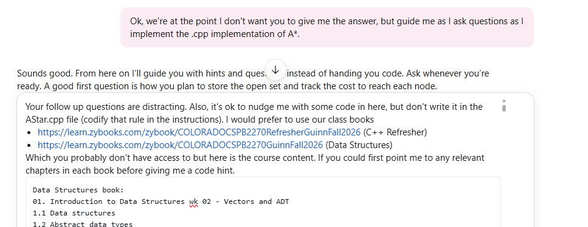

## Introduction
I’d like to focus on implementing a reinforcement learning algorithm for my final project. Specifically, something like a gridworld maze. I have seen this demoed before and appreciated it then, but want to get my hands dirty implementing it. I brought up q-learning in my proposal and it was recommended that I look into A*. I subscribed to algo-expert.io which has an explainer on A* and I hope to learn that algorithm and any surrounding algorithms in C++ (A language I'm newer to), in part as preparation to an algorithms course I plan to take next term. 

Ultimately, I am still most interested in implementing a reinforcement learning algorithm, even if it's a ambitious goal. I've completed a Applied Data Science certificate from MIT-PE, where I made an image classification model as a convolutional neural network, before, so I'm not starting from square one. The space of Ai alignment is something that interests me. 

Since I'm leveraging Ai in this project, I have to set a more challenging stretch goal to make it suitable as my final project. I intend to strike a balance between leveraging Ai as a tool for learning and not cognitively offloading the work. One project that I recently became familiar with is https://rubicon-eval.github.io/ where models are tested for whether the recognize they've been given an impossible task or if they know when they pass a 'point of no return.' I also listened to this article [How to read the AI mind](https://www.economist.com/podcasts/2026/09/23/how-to-read-the-ai-mind) a while back, which digs into whether Ai have "emotions" more or less and also this youtube video [How Stanford Teaches AI Coding Now](https://youtu.be/0_JtfuXVI10?si=S9EcOC1EEslsMvV_&t=1373) about traces. I'd like to aim to bring this all together in a way where I perhaps am able to trace the activations of an open weight local model in some way as it makes its way through a impossible gridworld maze to see if I can recognize any 'emotions' like doom when it passes the 'point of no return' or recognizes a puzzle is impossible. This is a pretty ambitious target, but I might learn some interesting things about CUDA++, which is something I've wanted to try. 

## Housekeeping
- This README.md file was handwritten (not generated or modified by Ai). The other .md files in this project are generated and serve as resources I can reference as I work through my project. 
- Since there are multiple things I'm trying to get done during this project, I am going to use this file as a 'checklist' of sorts that explains what has happened in each commit. I'll add items to the todo list and as I accomplish them, I'll check them off the todo list and commit them. 
- The final version of this project is likely to be more than what is required, so it might be beneficial to look at the project commit by commit. If you're on windows, you can use a `gitk --all` to see all the commits in a visualizer. At each step, I will add a new section to this readme explaining what I've done. 
- To make this less confusing (hopefully) I split the different 'Feature Todo' list items below into different branches and I plan to submit a PR against master for each one. This will hopefully help manage the clutter of working with AI generated clutter from the actual  each todo item will have several commits. So you should be able to look at the PR to see all the changes for a given todo list item. I also numbered them to make it easier. Each todo list item will have a separate section below, with a sub checklist that I will handle in commits. You can view changes by commit on github using the commit viewer. README.md is always hand written and some of the other readmes have some of my notes. 

## Feature Todo List
- 1. [ ] Implement a working version of A*
- 2. [ ] Implement a working version of q-learning
- 3. [ ] Leverage CUDA++ for q-learning
- 4. [ ] Research how to fabricate a visualization for activations of model
- 5. [ ] Build a step by step state logger that logs the state of each step, including the visual representation of the 'emotion'
- 6. [ ] Build an impossible puzzle and send the model through it
- 7. [ ] Analyze the results to see if any step might show an emotion like 'doom' when the model passes the point of no return or recognizes the model is impossible. 

# Notes
## Implement a working version of A*
After watching the tutorial of A* Algorithm, it seems pretty straight forward. However, it was also mentioning how it differs from Dijkstra's Algorithm. Since it brought up that algorithm, I thought I'd watch that video as well. It seems the heuristic used in A* expands directly toward the end location, whereas Dijstra's extends in every direction evenly. The tutorial walkthrough was in python. One thing that was interesting was how the instructor initialized the scores to infinity, I'll have to figure out how to do that. I did appreciate that I was able to follow the tutorial better than before. I had an Algo Expert membership before, but often didn't really follow the solutions that well, but after taking data structures, I'm following a lot easier. 
- [x] Review Piazza

### A* breakdown
I will now explain how to implement the algorithm. Basically, there is a m x n grid full of obstacles, a start and end. The algorithm assigns each cell 3 scores, H, G, F. H is the distance from the start, G is the distance to the end (calculated using a heuristic like the Manhattan Coefficient). F is just the addition of H and G. The algorithm assigns an F score to each eligible cell in the grid and proceeds along the optimal path (lowest number), so long as the H score for a given cell doesn't increase.  The algorithm itself puts the cells in a priority queue implemented as a min heap. At each step, the algorithm will also assign to the cell an arrow for the direction of the last cell visited, so that when execution reaches the end of the grid, it can build the optimal paths by following the arrows back to the start.
- [x] Watch A* video
- [x] Explain the algorithm in this project

## A* Complexity
During the video on A*, it discussed how to time complexity would be O(N) if N is w x h (the number of nodes in the graph). Then find the node with the smallest f score. Instead of that we should use a priority queue implemented as a min heap, which should take time complexity  O(Nlog(N)) where N = w * h. 

## Implement the A* algorithm
One of the components of the algorithm is implementing a min heap, which we did in C++ in class, but which I got some questions wrong on the final so I wanted to dig into it a bit more. I started by looking at the algorithm in Algo expert, but then realized that for A* I can probably just use the priority_queue within the std library in C++. Nevertheless, I reimplemented min heap in python along with A* and my plan is to move it into C++. 

The parts I found interesting is identifying the surrounding nodes and adding them to the neighbors array. 

- [x] Implement the A* algorithm in python
- [x] Watch Priority queue as min heap video
- [x] Provision python A* with tests

### Implement A* in C++
I cloned the priority queue repo into the project to get an idea for how to structure the C++ implementation. I then had Ai generate a readme describing step by step how to set up the structure. 

The setup was pretty straight forward, however, since I am newer to C++, the CMakeLists.txt file and CMakeLists.txt.in file were new to me so I stopped to read them over and learn a bit about what they do. 

I had Ai port over the tests so I had something to work toward when implementing my version of A*. The test code is always kind of a nightmare to get to work and more sophisticated than I'm ready for at the moment. I figure this is a good compromise. At least this way I can do some test driven development. 

  - [x] Look at homework assignments for min heap and project setup
    - [x] clone it into project to get structure
  - [x] 'min heap construction'

- [ ] Implement the A* in C++

I got a little side tracked here learning about submodules. I added [src/hw-05](src/hw-05) as a submodule and instructions for how to restore it (if you want/need) are located in [notes/submodules.md](notes/submodules.md) Ultimately, I was trying to copy over the .vscode tasks from homework-5 so I could use the debugger, but since I cloned it instead of installing it as a submodule, git tracked a link (file mode) without a .gitmodule url to the repo. So I had to modify the history, first by going back and recloning it and removing the .git file so the files appeared in this repo normally. However, then I wanted to learn about submodules so I checked out the parent commit and installed the submodule correctly. 

However, once I did that, I had changed the directory name from cu-cspb-2270-fall-2026-classroom-hw-05-priority-queue-sprintup to hw-05 for brevity, which was included in a previous commit. I then had to struggle through a git fixup using an interactive rebase that went too far back (where the original error didn't exist) which caused a great deal of confusion. I then had to reset hard my local ref to start over and use git blame to find the right commit to apply the fixup to and finally was able to update the readme to the right path. 

Then I was finally able to add the tasks from the homework that would allow me to use the debugger so I can start making the tests pass. 

- [x] Read missed sections on heaps sections on 
I'm going through different sections of the C++ book, finding how to make C++ implementations of different features of the algorithm. One feature I'm unable to find is how to initialize a float to infinity, which is part of the implementation from python for the values of g and f. As I was constructing the Node class I was searching for a way to initialize to infinity, but I can't find that section in the c++ book. I googled it and the top response was an Ai response, so I'm not sure how to avoid using the Ai response or if ignoring it would be valueable. Instead of needlessly getting low quality (straight answer) responses from google, I loaded an Ai session with a prompt to guide me instead of just giving me the answer. 

My prompt is fairly basic, and it makes me think there is probably an entire area of pedagogy around how best to structure an AI session for learning. That’s a rabbit hole I’m going to avoid for now, but it does raise an idea I think could be useful for professors, not just in this class: providing a prepared prompt that students can use to give an AI session the appropriate context for the course. That could help establish clearer expectations around how AI should be used as a learning tool, rather than leaving students unsure about what constitutes appropriate use. AI is becoming increasingly integrated into industry, so I think there is real value in teaching students how to use it effectively and responsibly. (this paragraph was cleaned up by Ai from a draft I wrote)

Once I loaded it with the table of content from the book, I was really pleased with it's ability to point to chapters to review where I felt like I got a 'breadth first example' from the text book instead of a direct answer from Ai. Even the code hints it provides were made up classes, which made me think more. It works especially well if you connect the model to your project and give it instructions to read only, because it can inspect your header file as well to give you better explanations. 

It was able to point to several chapters on constructors that I don't recall reading in the book (like 16.11 - Grouping Data: struct), which were really interesting to learn about. For instance, constructor initializer lists (7.12) within inline member functions(7.4). It's slightly better, because it initializes with a value instead of at zero and then allocating. Every question that I asked, it gave me chapters to read. While I didn't do the participation activities for each one, I did open them and read the instructive portions of the chapters. Another example is when I was pointed to reading about class templates when trying to initialize members to infinity using numeric_limits, which remind me of generics in C#. The experience of learning was really nice, it reduced the overhead of having to find the right material to read/review.    

One interesting thing was that because there are so many different ways to implement it, I still had to decide which data structure to use. For instance, it was encouraging me to use a struct instead of a class. I had initially wrote it as a class, based on basically my naive belief that everything should be a class (lol), but when I started asking why it should be a struct, it became clear this Node didn't really have any rules it needed to enforce so the getters/setters of a class would have just been needless overhead. Similarly, making the cameFrom property a pointer to the Node object (its own type) was a bit counter intuitive, but makes sense once it's implemented since it a pointer to a different instance. 

I will say the tests that the Ai generated were not as helpful as the tests from class, because they essentially required a fully functional algorithm to pass. Albeit, the different tests required different sized grids, it was much more helpful for each test to test a function within the algorithm, such that they built on each other until the algorithm was implemented. However, I couldn't just ask Ai do make those kinds of tests without also asking it to define the functions themselves. Nevertheless, the scaffold was sufficient to write some tests using the TDD methodology. I'm going to commit here and then move the tests over from the hw_5 for some more examples of those kinds of tests, but don't want this commit to have Ai code in it. 

### Testing 
I brought over the test for [priority queue](src/cpp/tests/test_priority_queue.cpp) and also added a [unit testing snippet](src/cpp/.vscode/cpp.code-snippets) that I can use to make some tests. The file [test_my_a_star.cpp](src/cpp/tests/test_my_a_star.cpp) is the file that I'm going to use to write my own tests for A*. 

- [ ] Watch Dijstra's algorithm video
