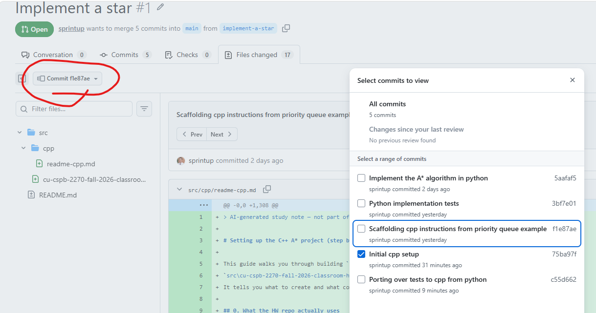

## Introduction
I’d like to focus on implementing a reinforcement learning algorithm for my final project. Specifically, something like a gridworld maze. I have seen this demoed before and appreciated it then, but want to get my hands dirty implementing it. I brought up q-learning in my proposal and it was recommended that I look into A*. I subscribed to algo-expert.io which has an explainer on A* and I hope to learn that algorithm and any surrounding algorithms in C++ (A language I'm newer to), in part as preparation to an algorithms course I plan to take next term. 

Ultimately, I am still most interested in implementing a reinforcement learning algorithm, even if it's a ambitious goal. I've completed a Applied Data Science certificate from MIT-PE, where I made an image classification model as a convolutional neural network, before, so I'm not starting from square one. The space of Ai alignment is something that interests me. 

Since I'm leveraging Ai in this project, I have to set a more challenging stretch goal to make it suitable as my final project. I intend to strike a balance between leveraging Ai as a tool for learning and not cognitively offloading the work. One project that I recently became familiar with is https://rubicon-eval.github.io/ where models are tested for whether the recognize they've been given an impossible task or if they know when they pass a 'point of no return.' I also listened to this article [How to read the AI mind](https://www.economist.com/podcasts/2026/09/23/how-to-read-the-ai-mind) a while back, which digs into whether Ai have "emotions" more or less and also this youtube video [How Stanford Teaches AI Coding Now](https://youtu.be/0_JtfuXVI10?si=S9EcOC1EEslsMvV_&t=1373) about traces. I'd like to aim to bring this all together in a way where I perhaps am able to trace the activations of an open weight local model in some way as it makes its way through a impossible gridworld maze to see if I can recognize any 'emotions' like doom when it passes the 'point of no return' or recognizes a puzzle is impossible. This is a pretty ambitious target, but I might learn some interesting things about CUDA++, which is something I've wanted to try. 

## Housekeeping
- This README.md file was handwritten (not generated or modified by Ai). The other .md files in this project are generated and serve as resources I can reference as I work through my project. 
- Since there are multiple things I'm trying to get done during this project, I am going to use this file as a 'checklist' of sorts that explains what has happened in each commit. I'll add items to the todo list and as I accomplish them, I'll check them off the todo list and commit them. 
- The final version of this project is likely to be more than what is required, so it might be beneficial to look at the project commit by commit. If you're on windows, you can use a `gitk --all` to see all the commits in a visualizer. At each step, I will add a new section to this readme explaining what I've done. 
- To make this less confusing (hopefully) I split the different 'Feature Todo' list items below into different branches and I plan to submit a PR against master for each one. This will hopefully help manage the clutter of working with AI generated clutter from the actual  each todo item will have several commits. So you should be able to look at the PR to see all the changes for a given todo list item. I also numbered them to make it easier. Each todo list item will have a separate section below, with a sub checklist that I will handle in commits. You can view changes by commit on github using the commit viewer. README.md is always hand written and some of the other readmes have some of my notes. 

## Feature Todo List
- 1. [ ] Implement a working version of A*
- 2. [ ] Implement a working version of q-learning
- 3. [ ] Leverage CUDA++ for q-learning
- 4. [ ] Research how to fabricate a visualization for activations of model
- 5. [ ] Build a step by step state logger that logs the state of each step, including the visual representation of the 'emotion'
- 6. [ ] Build an impossible puzzle and send the model through it
- 7. [ ] Analyze the results to see if any step might show an emotion like 'doom' when the model passes the point of no return or recognizes the model is impossible. 