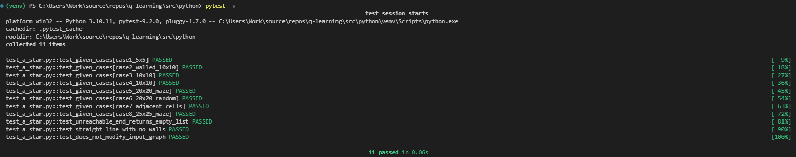

# Python implementation
I followed the lecture from algoexpert to implement it first in python, since I'm more comfortable in python, then thought I would switch to C++

I had Claude generate the test file using test cases I got from Algo-expert. I then installed a virtual environment and the pytest package and ran it with `pytest -v` and all the tests passed. 



# How to run python version
``` PS
cd into src\python
python -m venv venv
.\venv\Scripts\activate
pip install -r requirements.txt
pytest -v
```